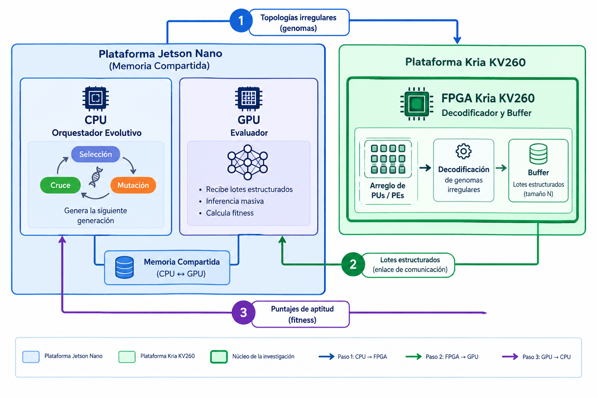
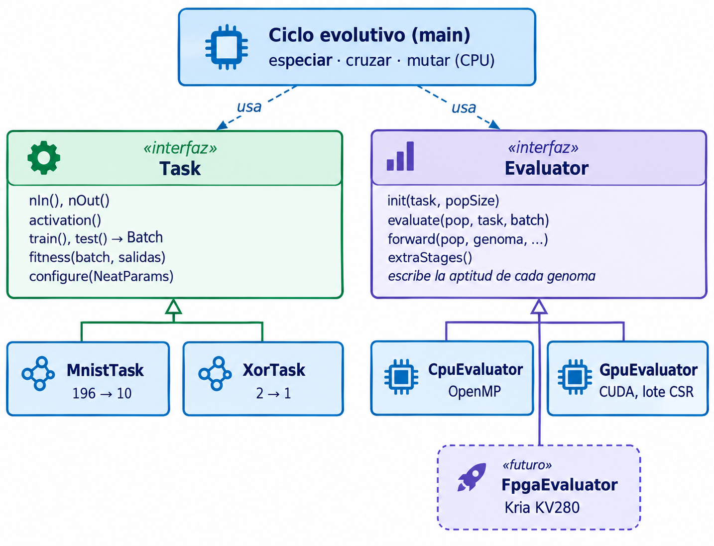
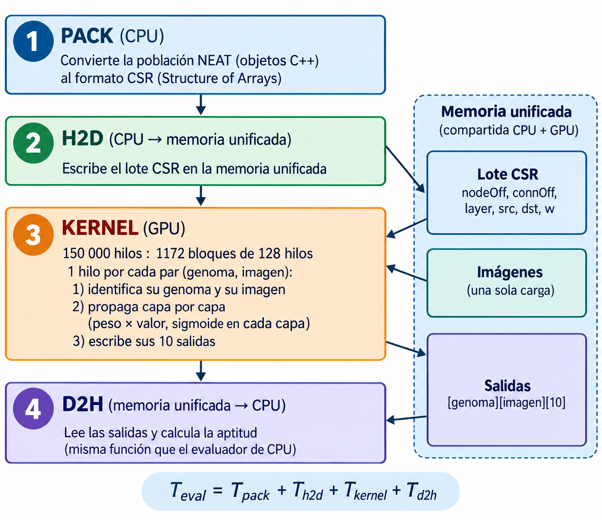

# Sistema evolutivo para entrenar redes neuronales en hardware heterogéneo

Este proyecto se desarrolla en el curso EL5859 Computación Heterogénea (ITCR) y busca distribuir el entrenamiento de redes neuronales mediante neuroevolución (NEAT) entre una CPU, una GPU y una FPGA. Para probar el enfoque, se utiliza un clasificador de dígitos del conjunto de datos MNIST.

El proyecto está pensado para ejecutarse en una NVIDIA Jetson Nano (CPU ARM y GPU) y una AMD/Xilinx Kria KV260 (FPGA). Por ahora, el trabajo está distribuido de la siguiente manera:

- La CPU ejecuta el algoritmo evolutivo (especiación, cruce y mutación).
- La GPU de la Jetson Nano evalúa la población por lotes con un kernel CUDA.
- La integración de la FPGA queda para una etapa posterior.

<p align="center"></p>

Como punto de partida se utiliza la biblioteca [NEAT de titofra](https://github.com/titofra/NEAT). Sobre esa base se incorporaron el caso de estudio, el programa genérico de neuroevolución (`neuroevo`), el evaluador para GPU y los scripts para medir el rendimiento.

## Estructura del repositorio

| Carpeta | Contenido |
|---|---|
| `src/`, `include/NEAT/` | Biblioteca NEAT (base del proyecto) |
| `lib/` | Biblioteca compilada (`libneat.a`) |
| `neuroevo/` | Programa principal. Tareas (MNIST, XOR), evaluadores en CPU y GPU, pruebas, perfilado y resultados |
| `neuroevo/docs/` | Arquitectura del software y diagramas |
| `examples/mnist/` | Primera versión del clasificador MNIST (prototipo en CPU), conjunto de datos MNIST y perfilado de la línea base |
| `examples/snake/`, `examples/template/` | Ejemplos originales de la biblioteca |
| `resources/` | Imágenes y video de la biblioteca original |

## Instalación y compilación

### Dependencias

```bash
sudo apt install build-essential cmake git libsfml-dev libgoogle-perftools-dev
```

- `libsfml-dev`: es una dependencia de la biblioteca NEAT, aunque este programa no utiliza ventanas.
- `libgoogle-perftools-dev`: se necesita para compilar `examples/mnist` y realizar el perfilado con gperftools.
- GPU (solo en la Jetson Nano): JetPack 4.6.x con CUDA 10.2. Si CMake no encuentra `nvcc`, agréguelo al `PATH`:

  ```bash
  export PATH=/usr/local/cuda/bin:$PATH
  ```

### 1. Biblioteca NEAT (una sola vez, desde la raíz del repositorio)

```bash
./unix_launch.sh          # genera lib/libneat.a
```

### 2a. Programa `neuroevo` en CPU

```bash
cd neuroevo
./unix_launch.sh          # genera build/neuroevo y build/neuroevo_tests
```

### 2b. Programa `neuroevo` con GPU (Jetson Nano)

```bash
cd neuroevo
cmake -H. -Bbuild -DNEUROEVO_WITH_CUDA=ON -DCMAKE_CUDA_FLAGS="-arch=sm_53"
make -C build
```

La opción `-arch=sm_53` compila el kernel para la GPU de la Jetson Nano (arquitectura Maxwell, compute capability 5.3). Al compilar con esta opción, se habilita el evaluador `gpu`. Para comprobarlo, ejecute `./build/neuroevo --help` y verifique que `gpu` aparezca en la lista de evaluadores.

## Uso

```bash
./build/neuroevo --task <mnist|xor> --eval <cpu|gpu> [opciones]
```

| Opción | Descripción |
|---|---|
| `--task` | Problema a resolver: `mnist` o `xor` |
| `--eval` | Dónde se evalúa la población: `cpu` (OpenMP) o `gpu` (CUDA) |
| `--gens`, `--pop` | Generaciones y tamaño de la población |
| `--train`, `--test` | Cantidad de imágenes de entrenamiento y de prueba |
| `--seed` | Semilla (con la misma semilla y un hilo, los resultados se repiten) |
| `--threads` | Hilos de OpenMP |
| `--csv` | Archivo de salida con una fila por generación |
| `--help` | Lista completa de opciones |

### Ejemplos

```bash
# MNIST en CPU (configuración usada en el perfilado)
./build/neuroevo --task mnist --eval cpu --gens 100 --train 1000 --pop 150 --seed 42
# MNIST con la evaluación en GPU (Jetson Nano)
./build/neuroevo --task mnist --eval gpu --gens 100 --train 1000 --pop 150 --seed 42
# XOR: problema pequeño para verificar que el programa no depende de MNIST
./build/neuroevo --task xor --seed 1
```

### Resultados esperados

En la Jetson Nano, la configuración utilizada para el perfilado fue de 100 generaciones, 1000 imágenes, una población de 150 individuos y la semilla 42. Los tiempos y la exactitud obtenidos fueron los siguientes:

| Evaluador | Tiempo total | Exactitud final (entrenamiento / prueba) |
|---|---|---|
| CPU, 1 hilo | ≈ 932 s | ≈ 63 % / ≈ 55 % |
| GPU | ≈ 546 s | ≈ 63 % / ≈ 54 % |

Durante cada generación, la consola muestra la exactitud alcanzada y el tiempo que toma cada etapa: evaluación, especiación, cruce y mutación. Al finalizar, se generan los siguientes archivos:

- `mnist_neat_log.csv`: una fila por generación, con exactitud, tiempos por etapa y conexiones promedio. Con `--eval gpu` incluye además `t_pack`, `t_h2d`, `t_kernel` y `t_d2h`.
- `mnist_neat_backup.txt`: la población final (se omite con `--no-save`).

## Pruebas

Todos los comandos se ejecutan desde `neuroevo/`.

### Pruebas automáticas

```bash
./build/neuroevo_tests
```

Estas pruebas no necesitan los datos de MNIST. Verifican que una red XOR creada manualmente se evalúe correctamente y que el evaluador obtenga la misma aptitud que la tarea al procesar sus salidas. El resultado esperado es `todas pasan`.

### Regresión contra la versión anterior

```bash
cd ../examples/mnist && ./unix_launch.sh && cd ../../neuroevo   # compila la versión anterior (referencia)
./tests/regression.sh
```

La prueba ejecuta la versión anterior del clasificador y `neuroevo` con la misma semilla. Después compara, generación por generación, la exactitud y la cantidad de conexiones. Si todo coincide, muestra `REGRESION OK: 25 generaciones identicas`. Se utiliza un solo hilo porque, con varios hilos, el orden en que se agregan los descendientes durante el cruce puede variar entre ejecuciones.

Los experimentos de referencia del prototipo anterior (efecto de cada corrección y varias semillas) están en [`examples/mnist/README.md`](examples/mnist/README.md).

## Arquitectura del software

El diseño separa la definición del problema del dispositivo que evalúa la población. Para hacerlo, utiliza dos interfaces principales:

- `Task` (tarea) define los datos, la función de activación y la aptitud. Implementaciones: `MnistTask` y `XorTask`.
- `Evaluator` (evaluador) calcula la aptitud de toda la población. Implementaciones: `CpuEvaluator` (OpenMP) y `GpuEvaluator` (CUDA).

<p align="center"></p>

El ciclo evolutivo trabaja únicamente con estas interfaces. En cada generación llama a `evaluate()` para calcular la aptitud y después realiza la especiación, el cruce y la mutación en la CPU. La selección del evaluador ocurre en dos momentos:

1. Al compilar, `-DNEUROEVO_WITH_CUDA=ON` agrega el código de GPU y lo registra en `src/registry.cpp`.
2. Al ejecutar, `--eval` indica qué evaluador crea `makeEvaluator()`.

Para incorporar otro dispositivo, como la FPGA, se debe implementar un nuevo `Evaluator` y registrarlo. La guía para agregar tareas o evaluadores está en [`neuroevo/README.md`](neuroevo/README.md). Los diagramas y detalles de la arquitectura se encuentran en [`neuroevo/docs/ARQUITECTURA.md`](neuroevo/docs/ARQUITECTURA.md).

### Evaluación en GPU

En cada generación, la CPU prepara la población y la coloca en memoria unificada. Luego, la GPU evalúa cada combinación de genoma e imagen mediante un hilo. Con las salidas obtenidas, la CPU calcula la aptitud. El tiempo de cada etapa se registra por separado:

<p align="center"></p>

## Decisiones de diseño

### Formato del lote

En cada generación, la población se organiza en un formato disperso similar a CSR, con un arreglo para cada campo. Solo se guardan las conexiones habilitadas, por lo que cada genoma mantiene su propia topología sin agregar espacio para conexiones que no existen:

| Arreglo | Tipo | Contenido |
|---|---|---|
| `nodeOff`, `connOff` | int32 | Inicio de los nodos y de las conexiones de cada genoma |
| `layer` | int32 | Capa de cada nodo |
| `src`, `dst` | int32 | Nodo de origen y de destino de cada conexión |
| `w` | float32 | Peso de cada conexión |

Las imágenes se cargan al inicio y se reutilizan durante todas las generaciones, ya que el conjunto de datos no cambia. La CPU calcula la aptitud con la misma función utilizada por el evaluador de CPU. Así, las evaluaciones de ambos dispositivos se pueden comparar con una misma referencia.

### Memoria

Se utiliza memoria unificada (`cudaMallocManaged`). Como la CPU y la GPU de la Jetson Nano comparten la memoria física, no es necesario realizar copias explícitas entre ambas. La memoria se reserva una sola vez al inicio, tomando como referencia un espacio equivalente a tres veces el promedio de conexiones por genoma. Si alguna generación supera esa capacidad, el programa se detiene y muestra un mensaje de error.

### Validación

Para validar un evaluador nuevo, se procesa la misma población con ese evaluador y con `CpuEvaluator`, y luego se comparan los resultados. En precisión simple (FP32), la diferencia de aptitud debe ser como máximo `1/nSamples` en al menos el 99 % de los genomas.

## Resultados

### Línea base en CPU (prototipo anterior)

El perfilado de la primera versión se realizó con 200 generaciones, 2000 imágenes y una población de 150 individuos. Los resultados mostraron que la evaluación consumía cerca del 60 % del tiempo total, mientras que el cruce representaba entre el 19 y el 25 %, y la especiación entre el 13 y el 16 %. Al paralelizar la evaluación y el cruce con OpenMP, el tiempo de ejecución se redujo de 193.95 s a 90.91 s, una mejora de 2.13×. El detalle de estas pruebas está en [`examples/mnist/profiling/README.md`](examples/mnist/profiling/README.md).

### Prototipo con acelerador

Con `neuroevo`, el perfilado se repitió tanto en PC1 como en la Jetson Nano. Todas las pruebas utilizaron 100 generaciones, 1000 imágenes, una población de 150 individuos y la semilla 42, con cinco ejecuciones por configuración. Como se mide cada etapa en cada generación, se obtuvieron 500 muestras por etapa para cada configuración.

| Configuración | Tiempo (s) | Aceleración | CPUs usadas | Evaluación | Cruce | Especiación |
|---|---|---|---|---|---|---|
| PC1, 1 hilo | 96.71 ± 0.03 | — | 1.0 | 38.7 % | 38.7 % | 20.3 % |
| PC1, OpenMP | 39.25 ± 0.36 | 2.46× | 3.6 | 46.4 % | 48.3 % | 0.6 % |
| Jetson, 1 hilo | 931.99 ± 0.28 | — | 1.0 | 48.2 % | 27.4 % | 22.5 % |
| Jetson, OpenMP (2 hilos) | 815.36 ± 1.14 | 1.14× | 1.1 | 47.3 % | 26.8 % | 22.4 % |
| Jetson, CPU + GPU | 546.06 ± 0.27 | 1.71× | 0.9 | 14.3 % | 45.8 % | 38.3 % |

Los porcentajes muestran el tiempo propio de cada función según `perf`. En la configuración CPU + GPU, los porcentajes se calculan respecto al tiempo total, y la evaluación incluye todo el tiempo empleado por el evaluador de GPU.

Desglose del tiempo de evaluación en GPU (100 generaciones, media de 5 corridas):

| Etapa | Tiempo (s) | % de la evaluación |
|---|---|---|
| `pack` | 0.64 | 0.8 % |
| `h2d` | 0.42 | 0.5 % |
| `kernel` | 75.95 | 97.1 % |
| `d2h` | 1.21 | 1.5 % |
| Total | 78.22 | 100 % |

A partir de estos resultados, se pueden destacar varios puntos:

- En la Jetson Nano, la evaluación baja de unos 449 s con un hilo de CPU a 78 s en la GPU, lo que equivale a una aceleración de 5.7×. Sin embargo, el tiempo total mejora 1.71×, ya que la especiación y el cruce todavía se ejecutan en la CPU.
- El kernel representa el 97 % del tiempo de evaluación. Como la memoria unificada reduce la necesidad de mover datos, una de las principales oportunidades de mejora está en optimizar el kernel.
- Cuando la evaluación se traslada a la GPU, el cruce y la especiación pasan a representar el 84 % del tiempo. Por eso, se convierten en el principal cuello de botella.
- En la Jetson Nano, OpenMP se probó con dos hilos y únicamente la evaluación se ejecuta en paralelo. Esto ayuda a explicar por qué la mejora es de solo 1.14×.

### Reproducir el perfilado

Los scripts de perfilado y los resultados completos se encuentran en [`neuroevo/profiling/`](neuroevo/profiling/README.md). Ejecutan el programa varias veces y utilizan `perf`, `gperftools` y, para las pruebas con GPU, `nvprof`. Al final, guardan los promedios y las desviaciones estándar:

```bash
cd neuroevo
./profiling/profiling.sh          ./build/neuroevo mnist cpu 100 1000 150 42 5 ./resultados_cpu
./profiling/profiling_with_gpu.sh ./build/neuroevo mnist gpu 100 1000 150 42 5 ./resultados_gpu
```

Los argumentos son: binario, tarea, evaluador, generaciones, imágenes, población, semilla, número de corridas y carpeta de salida.

## Próximos pasos

- Validar el evaluador en GPU frente al de CPU genoma a genoma y medir el consumo de potencia con `tegrastats`.
- Optimizar el kernel: acceso contiguo a las imágenes, menos memoria local por hilo, conexiones en memoria compartida, recorrido de las conexiones ordenado por capa y una aproximación más barata de la sigmoide.
- Acelerar el cruce y la especiación, que ahora concentran la mayor parte del tiempo.
- Ejecutar en la Jetson Nano con sus cuatro núcleos de CPU.
- Generalizar el evaluador en GPU para que use la función de activación de cada tarea.
- Integrar la Kria KV260 para decodificar los genomas.

## Demostraciones

[](https://www.youtube.com/watch?v=gNGZxSdEBlY)

<!-- Agregar aquí el video del prototipo con GPU -->

## Créditos

- Integrantes: Jennifer Porras Rojas, Esteban Sánchez Acevedo, Gael Agüero Carrillo y Luis Diego García Rojas.
- Curso EL5859 Computación Heterogénea, Instituto Tecnológico de Costa Rica.
- Biblioteca base: [titofra/NEAT](https://github.com/titofra/NEAT), basada en el algoritmo NEAT de Kenneth O. Stanley y Risto Miikkulainen.
- Lector y datos de MNIST: [wichtounet/mnist](https://github.com/wichtounet/mnist) (licencia MIT).
