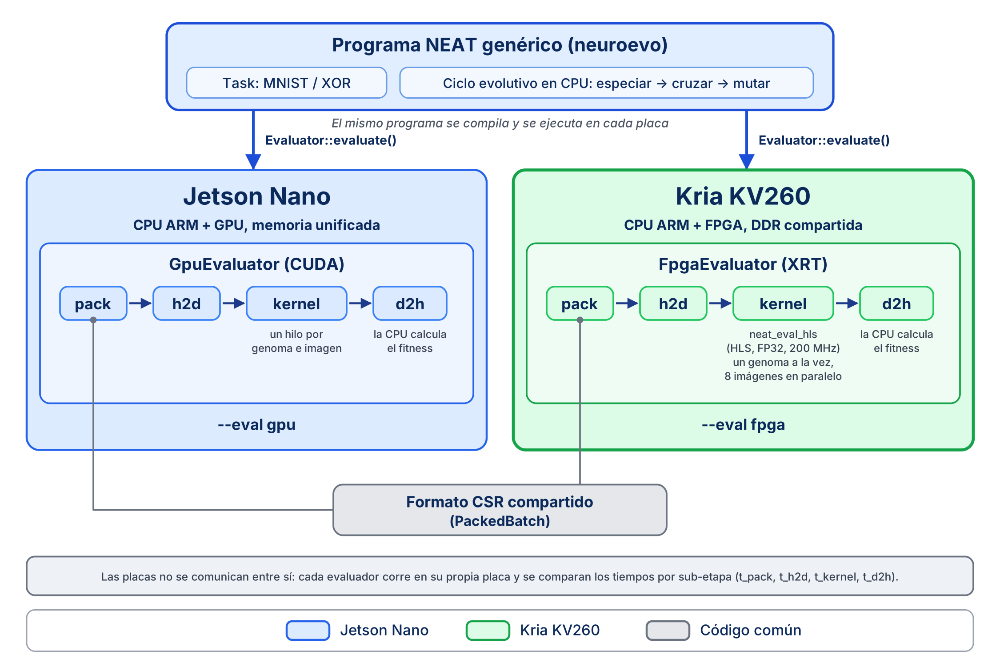
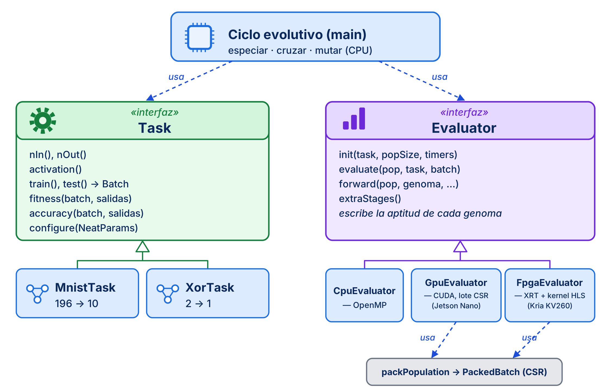
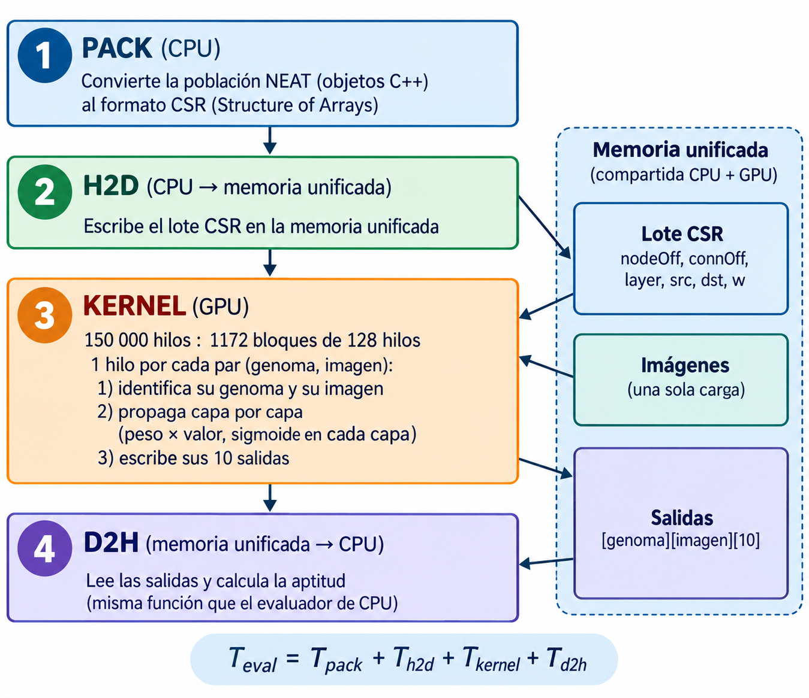
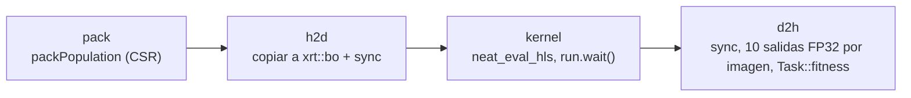

# Sistema evolutivo para entrenar redes neuronales en hardware heterogéneo

Este proyecto se desarrolla en el curso EL5859 Computación Heterogénea (ITCR) y busca distribuir el entrenamiento de redes neuronales mediante neuroevolución (NEAT) entre una CPU, una GPU y una FPGA. Para probar el enfoque, se utiliza un clasificador de dígitos del conjunto de datos MNIST.

El proyecto está pensado para ejecutarse en una NVIDIA Jetson Nano (CPU ARM y GPU) y una AMD/Xilinx Kria KV260 (CPU ARM y FPGA). El trabajo está distribuido de la siguiente manera:

- La CPU ejecuta el algoritmo evolutivo (especiación, cruce y mutación).
- La GPU de la Jetson Nano evalúa la población por lotes con un kernel CUDA, con tres optimizaciones acumuladas.
- La FPGA de la Kria KV260 evalúa la población con un kernel HLS en punto flotante de 32 bits (variante `v2_lanes8`), que corre desde el mismo programa y con el mismo lote que la GPU.

<p align="center"></p>

Como punto de partida se utiliza la biblioteca [NEAT de titofra](https://github.com/titofra/NEAT). Sobre esa base se incorporaron el caso de estudio, el programa genérico de neuroevolución (`neuroevo`), los evaluadores para GPU y FPGA, el kernel HLS y los scripts para medir el rendimiento.

El informe del proyecto (paper) detalla la metodología y el análisis. Este README resume lo necesario para compilar, reproducir y entender los resultados.

## Estructura del repositorio

| Carpeta | Contenido |
|---|---|
| `src/`, `include/NEAT/` | Biblioteca NEAT (base del proyecto) |
| `lib/` | Biblioteca compilada (`libneat.a`) |
| `neuroevo/` | Programa principal. Tareas (MNIST, XOR), evaluadores, pruebas, perfilado y resultados |
| `neuroevo/src/` | Evaluador de CPU y de GPU (`gpu_evaluator.cu`) y empaquetado de la población en formato CSR |
| `neuroevo/fpga/hw/` | Kernel HLS `neat_eval_hls` (5 variantes), testbench, scripts de síntesis y reportes de Vitis. Ver [`fpga/hw/README.md`](neuroevo/fpga/hw/README.md) |
| `neuroevo/fpga/sw/` | Evaluador de FPGA para el host (`FpgaEvaluator`, XRT), registro de evaluadores y `bench_lanes8.sh` |
| `neuroevo/fpga/binaries/` | `.xclbin`, `.bit.bin`, `.dtbo` y `shell.json` de cada variante del kernel (≈ 75 MB en total) |
| `neuroevo/tests/` | Pruebas automáticas, regresión contra la versión anterior y validación FPGA contra CPU |
| `neuroevo/profiling/` | Scripts y resultados del perfilado en CPU y GPU. Ver [`profiling/README.md`](neuroevo/profiling/README.md) |
| `neuroevo/results/` | Resultados sin procesar: CPU, GPU (tres optimizaciones) y FPGA (`results/fpga_f3/`) |
| `neuroevo/docs/` | Arquitectura del software y acuerdos host–kernel de la FPGA |
| `examples/mnist/` | Primera versión del clasificador MNIST (prototipo en CPU), conjunto de datos MNIST y perfilado de la línea base |
| `examples/snake/`, `examples/template/` | Ejemplos originales de la biblioteca |
| `docs/img/` | Diagramas de este README |
| `resources/` | Imágenes y video de la biblioteca original |

## Instalación y compilación

### Dependencias

```bash
sudo apt install build-essential cmake git libsfml-dev libgoogle-perftools-dev
```

- `libsfml-dev`: es una dependencia de la biblioteca NEAT, aunque este programa no utiliza ventanas.
- `libgoogle-perftools-dev`: se necesita para compilar `examples/mnist` y realizar el perfilado con gperftools.
- GPU (solo en la Jetson Nano): JetPack 4.6.x con CUDA 10.2. Si CMake no encuentra `nvcc`, agréguelo al `PATH`:

  ```bash
  export PATH=/usr/local/cuda/bin:$PATH
  ```

- FPGA (solo en la Kria KV260): XRT instalado y la herramienta `xmutil` para cargar el *bitstream*. Para sintetizar el kernel desde cero (opcional, los binarios ya están en `neuroevo/fpga/binaries/`) se necesita Vitis 2024.1.

### 1. Biblioteca NEAT (una sola vez, desde la raíz del repositorio)

```bash
./unix_launch.sh          # genera lib/libneat.a
```

`libneat.a` depende de la arquitectura. Si va a compilar en la Kria (aarch64), hay que generarla allí, no copiar la de otra máquina.

### 2a. Programa `neuroevo` en CPU

```bash
cd neuroevo
./unix_launch.sh          # genera build/neuroevo y build/neuroevo_tests
```

### 2b. Programa `neuroevo` con GPU (Jetson Nano)

```bash
cd neuroevo
cmake -H. -Bbuild -DNEUROEVO_WITH_CUDA=ON -DCMAKE_CUDA_FLAGS="-arch=sm_53"
make -C build
```

La opción `-arch=sm_53` compila el kernel para la GPU de la Jetson Nano (arquitectura Maxwell, compute capability 5.3). Al compilar con esta opción, se habilita el evaluador `gpu`. Para comprobarlo, ejecute `./build/neuroevo --help` y verifique que `gpu` aparezca en la lista de evaluadores.

### 2c. Programa `neuroevo` con FPGA (Kria KV260)

Se compila en la propia Kria, porque el evaluador usa XRT:

```bash
cd neuroevo
cmake -H. -Bbuild -DNEUROEVO_WITH_FPGA=ON
make -C build -j4          # genera build/neuroevo, build/neuroevo_tests y build/neuroevo_fpga_tests
```

El CMake busca XRT en `/opt/xilinx/xrt` y en `/usr`. Si no lo encuentra, cargue el entorno con `source /opt/xilinx/xrt/setup.sh` o indique la ruta con `-DXILINX_XRT=<ruta>`. Para comprobarlo, `./build/neuroevo --help` debe listar `fpga` entre los evaluadores.

**Sin la placa:** se puede validar el host, el empaquetado y el CSV en cualquier PC con un modelo en software del kernel (no mide el rendimiento del hardware):

```bash
cmake -H. -Bbuild -DNEUROEVO_FPGA_EMU=ON && make -C build -j4
./build/neuroevo_fpga_tests
```

Acuerdos entre el host y el kernel (argumentos, límites y tipos) está en [`neuroevo/docs/FPGA_INTERFAZ.md`](neuroevo/docs/FPGA_INTERFAZ.md).

## Uso

```bash
./build/neuroevo --task <mnist|xor> --eval <cpu|gpu|fpga> [opciones]
```

| Opción | Descripción |
|---|---|
| `--task` | Problema a resolver: `mnist` o `xor` |
| `--eval` | Dónde se evalúa la población: `cpu` (OpenMP), `gpu` (CUDA) o `fpga` (kernel HLS en la Kria) |
| `--xclbin` | Archivo `.xclbin` del kernel (solo con `--eval fpga`; equivale a la variable `NEUROEVO_XCLBIN`) |
| `--gens`, `--pop` | Generaciones y tamaño de la población |
| `--train`, `--test` | Cantidad de imágenes de entrenamiento y de prueba |
| `--seed` | Semilla (con la misma semilla y un hilo, los resultados se repiten) |
| `--threads` | Hilos de OpenMP |
| `--csv` | Archivo de salida con una fila por generación |
| `--help` | Lista completa de opciones |

### Ejemplos

```bash
# MNIST en CPU (configuración usada en el perfilado)
./build/neuroevo --task mnist --eval cpu --gens 100 --train 1000 --pop 150 --seed 42
# MNIST con la evaluación en GPU (Jetson Nano)
./build/neuroevo --task mnist --eval gpu --gens 100 --train 1000 --pop 150 --seed 42
# MNIST con la evaluación en FPGA (Kria KV260, con el bitstream ya cargado; ver más abajo)
./build/neuroevo --task mnist --eval fpga --xclbin fpga/binaries/v2_lanes8/neat_eval_hls.xclbin \
                 --gens 100 --train 1000 --pop 150 --seed 42
# XOR: problema pequeño para verificar que el programa no depende de MNIST
./build/neuroevo --task xor --seed 1
```

### Ejecutar en la FPGA (Kria KV260)

Antes de usar `--eval fpga`, hay que registrar y cargar el *bitstream* de la variante elegida con `xmutil` (necesita `sudo`). La variante usada en los resultados es `v2_lanes8`:

```bash
cd neuroevo
sudo mkdir -p /lib/firmware/xilinx/neat_eval_hls
sudo cp fpga/binaries/v2_lanes8/{neat_eval_hls.bit.bin,neat_eval_hls.dtbo,shell.json} /lib/firmware/xilinx/neat_eval_hls/
sudo xmutil unloadapp
sudo xmutil loadapp neat_eval_hls
```

Si cambia de variante, repita estos pasos con los archivos de esa variante y use el `.xclbin` de la misma carpeta. La Kria puede estar compartida con otros grupos, así que conviene revisar con `xmutil listapps` que nadie esté usando otra aplicación antes de descargarla.

El script `fpga/sw/bench_lanes8.sh` automatiza todo el flujo: comprueba que la placa no esté ocupada por otra aplicación, carga el *bitstream* de `v2_lanes8`, valida el kernel contra `CpuEvaluator`, ejecuta el perfilado y calcula las estadísticas por etapa. Es reanudable (omite las corridas que ya tienen su CSV) y, como una corrida completa dura alrededor de 2.3 horas, conviene lanzarlo dentro de `tmux`:

```bash
cd neuroevo
QUICK=1 ./fpga/sw/bench_lanes8.sh     # prueba rápida: 1 corrida de 5 generaciones (~1.5 min)
./fpga/sw/bench_lanes8.sh             # 5 corridas x 100 generaciones (semillas 42 a 46)
```

Pide la contraseña de `sudo` y guarda los resultados en `results/fpga_f3/v2_lanes8/`. Si hay otra aplicación activa en la placa, el script se detiene; solo use `FORCE=1` si confirmó que nadie la usa.

### Resultados esperados

La configuración utilizada para el perfilado fue de 100 generaciones, 1000 imágenes y una población de 150 individuos. Los tiempos y la exactitud obtenidos fueron los siguientes:

| Placa | Evaluador | Tiempo total | Exactitud final (entrenamiento / prueba) |
|---|---|---|---|
| Jetson Nano | CPU, 1 hilo | ≈ 932 s | ≈ 63 % / ≈ 55 % |
| Jetson Nano | GPU (versión inicial) | ≈ 546 s | ≈ 63 % / ≈ 54 % |
| Jetson Nano | GPU (3 optimizaciones) | ≈ 397 s | ≈ 66 % / ≈ 55 % (media de 5 corridas) |
| Kria KV260 | FPGA (`v2_lanes8`) | ≈ 1605 s (semilla 42) | ≈ 63 % / ≈ 53 % |

Los tiempos totales de la Jetson y de la Kria no son comparables entre sí: las CPU de las dos placas son distintas (la especiación y el cruce tardan unas 2.4 veces más en la Kria), y las corridas de la Jetson usaron 2 hilos de OpenMP y las de la Kria 4. Para comparar los aceleradores se usa el tiempo de evaluación (ver [Resultados](#resultados)).

Durante cada generación, la consola muestra la exactitud alcanzada y el tiempo que toma cada etapa: evaluación, especiación, cruce y mutación. Al finalizar, se generan los siguientes archivos:

- `mnist_neat_log.csv`: una fila por generación, con exactitud, tiempos por etapa y conexiones promedio. Con `--eval gpu` o `--eval fpga` incluye además `t_pack`, `t_h2d`, `t_kernel` y `t_d2h`.
- `mnist_neat_backup.txt`: la población final (se omite con `--no-save`).

## Pruebas

Todos los comandos se ejecutan desde `neuroevo/`.

### Pruebas automáticas

```bash
./build/neuroevo_tests
```

Estas pruebas no necesitan los datos de MNIST. Verifican que una red XOR creada manualmente se evalúe correctamente y que el evaluador obtenga la misma aptitud que la tarea al procesar sus salidas. El resultado esperado es `todas pasan`.

### Validación del evaluador de FPGA contra la CPU

```bash
export NEUROEVO_XCLBIN=$PWD/fpga/binaries/v2_lanes8/neat_eval_hls.xclbin   # solo con hardware
./build/neuroevo_fpga_tests
```

La prueba evalúa la misma población y el mismo lote con `FpgaEvaluator` y con `CpuEvaluator`, y compara la aptitud genoma a genoma. Tiene dos casos: el XOR armado a mano (8 genomas, tolerancia 0.25) y 40 genomas aleatorios con nodos ocultos sobre MNIST reducido, donde exige que el 100 % de los genomas coincida con tolerancia 0.001. Como la exactitud elevada a la cuarta potencia da valores casi nulos en una población aleatoria, la prueba cambia la aptitud por una métrica continua, `1/(1+ECM)` contra la salida *one-hot*, que sí detecta salidas incorrectas. El resultado esperado es `todas pasan`, con una diferencia máxima de 0.0000 en ambos casos. Funciona con la placa y en modo emulación.

### Regresión contra la versión anterior

```bash
cd ../examples/mnist && ./unix_launch.sh && cd ../../neuroevo   # compila la versión anterior (referencia)
./tests/regression.sh
```

La prueba ejecuta la versión anterior del clasificador y `neuroevo` con la misma semilla. Después compara, generación por generación, la exactitud y la cantidad de conexiones. Si todo coincide, muestra `REGRESION OK: 25 generaciones identicas`. Se utiliza un solo hilo porque, con varios hilos, el orden en que se agregan los descendientes durante el cruce puede variar entre ejecuciones.

Los experimentos de referencia del prototipo anterior (efecto de cada corrección y varias semillas) están en [`examples/mnist/README.md`](examples/mnist/README.md).

## Arquitectura del software

El diseño separa la definición del problema del dispositivo que evalúa la población. Para hacerlo, utiliza dos interfaces principales:

- `Task` (tarea) define los datos, la función de activación y la aptitud. Implementaciones: `MnistTask` y `XorTask`.
- `Evaluator` (evaluador) calcula la aptitud de toda la población. Implementaciones: `CpuEvaluator` (OpenMP), `GpuEvaluator` (CUDA) y `FpgaEvaluator` (XRT, kernel HLS).

<p align="center"></p>

El ciclo evolutivo trabaja únicamente con estas interfaces. En cada generación llama a `evaluate()` para calcular la aptitud y después realiza la especiación, el cruce y la mutación en la CPU. La selección del evaluador ocurre en dos momentos:

1. Al compilar, `-DNEUROEVO_WITH_CUDA=ON` o `-DNEUROEVO_WITH_FPGA=ON` agregan el código del acelerador y lo registran en `fpga/sw/registry.cpp`.
2. Al ejecutar, `--eval` indica qué evaluador crea `makeEvaluator()`.

Para incorporar otro dispositivo se debe implementar un nuevo `Evaluator` y registrarlo. La guía para agregar tareas o evaluadores está en [`neuroevo/README.md`](neuroevo/README.md). Los diagramas y detalles de la arquitectura se encuentran en [`neuroevo/docs/ARQUITECTURA.md`](neuroevo/docs/ARQUITECTURA.md).

### Evaluación en GPU

En cada generación, la CPU prepara la población y la coloca en memoria unificada. Luego, la GPU evalúa cada combinación de genoma e imagen mediante un hilo. Con las salidas obtenidas, la CPU calcula la aptitud. El tiempo de cada etapa se registra por separado:

<p align="center"></p>

### Evaluación en FPGA

El evaluador corre en la CPU ARM de la Kria, que comparte la DDR con la FPGA, y usa la API nativa de XRT. Las cuatro sub-etapas son las mismas que en la GPU, para poder compararlas:



A diferencia de la GPU, donde cada par genoma–imagen es un hilo, el kernel de la FPGA procesa **un genoma a la vez**: copia sus nodos y conexiones de la DDR a BRAM una sola vez y reutiliza esa red con todas las imágenes. En la variante `v2_lanes8`, 8 imágenes se procesan en paralelo compartiendo los pesos (cada *lane* tiene su propio arreglo de valores por nodo). Además, el kernel devuelve las diez salidas en FP32 por imagen, y la CPU calcula la aptitud en `d2h`, mientras que el kernel de la GPU solo devuelve el índice de la salida mayor.

El kernel se probó en cinco versiones: `v0_base` (traducción directa del kernel de GPU), `v1_pipeline` (con la directiva `PIPELINE`) y `v2_lanes2`, `v2_lanes4` y `v2_lanes8` (2, 4 y 8 imágenes en paralelo). Los detalles de cada versión, el testbench y los comandos de síntesis están en [`neuroevo/fpga/hw/README.md`](neuroevo/fpga/hw/README.md).

## Decisiones de diseño

### Formato del lote

En cada generación, la población se organiza en un formato disperso similar a CSR, con un arreglo para cada campo. Solo se guardan las conexiones habilitadas, por lo que cada genoma mantiene su propia topología sin agregar espacio para conexiones que no existen:

| Arreglo | Tipo | Contenido |
|---|---|---|
| `nodeOff`, `connOff` | int32 | Inicio de los nodos y de las conexiones de cada genoma |
| `layer` | int32 | Capa de cada nodo |
| `src`, `dst` | int32 | Nodo de origen y de destino de cada conexión |
| `w` | float32 | Peso de cada conexión |

Las imágenes se cargan al inicio y se reutilizan durante todas las generaciones, ya que el conjunto de datos no cambia. La CPU calcula la aptitud con la misma función utilizada por el evaluador de CPU. Así, las evaluaciones de los tres dispositivos se pueden comparar con una misma referencia. El kernel de la FPGA recibe exactamente este lote.

### Memoria

- **GPU:** se utiliza memoria unificada (`cudaMallocManaged`). Como la CPU y la GPU de la Jetson Nano comparten la memoria física, no es necesario realizar copias explícitas entre ambas.
- **FPGA:** los ocho punteros del kernel se asignan a buffers `xrt::bo` mapeados en la DDR compartida de la Kria; solo se sincroniza con la FPGA la parte usada de cada buffer en cada generación. Las 1000 imágenes de entrenamiento (≈ 0.78 MB en FP32) se suben una sola vez.

En ambos casos la memoria se reserva una sola vez al inicio, tomando como referencia un espacio equivalente a tres veces el promedio de conexiones por genoma. Si alguna generación supera esa capacidad, el programa se detiene y muestra un mensaje de error.

### Límites del kernel de FPGA

La red de cada genoma debe caber en la BRAM del kernel: como máximo 512 nodos y 6144 conexiones. Si un genoma los excede, el kernel devuelve ceros sin avisar y la aptitud sale errónea. Por eso `FpgaEvaluator::evaluate()` revisa ambos límites antes de lanzar el kernel y detiene la ejecución con un error explícito (el límite de nodos del host es 500, definido en `fpga_abi.hpp`, y el de conexiones es el `MAX_CONNS` del kernel). Estos topes dan holgura de unos 300 nodos ocultos y el triple de conexiones sobre la red inicial de MNIST reducido (207 nodos y 1970 conexiones).

### Tipo de dato

El kernel entregado trabaja en punto flotante de 32 bits (`typedef float data_t`) y calcula la sigmoide con `hls::exp`, igual que la GPU. El host tiene soporte provisional para punto fijo (`-DNEUROEVO_FPGA_FIXED=ON`, `int16`), pero el kernel de punto fijo y la tabla de búsqueda (LUT) de la sigmoide **no están implementados**: quedan como trabajo próximo.

### Validación

Para validar un evaluador nuevo, se procesa la misma población con ese evaluador y con `CpuEvaluator`, y luego se comparan los resultados. En el caso de la GPU, se compararon 50 genomas y la diferencia máxima de aptitud fue 0. En el caso de la FPGA se usa `neuroevo_fpga_tests` (ver [Pruebas](#pruebas)): 8/8 genomas del XOR y 40/40 de MNIST coinciden con la CPU, con diferencia máxima 0. Que la diferencia sea exactamente cero es esperable porque ambos lados usan FP32. Esta prueba no cubre genomas cercanos a los límites de nodos o conexiones del kernel (los genomas probados tienen entre 207 y 212 nodos), ni mide error de punto fijo o de LUT.

## Resultados

### Línea base en CPU (prototipo anterior)

El perfilado de la primera versión se realizó con 200 generaciones, 2000 imágenes y una población de 150 individuos. Los resultados mostraron que la evaluación consumía cerca del 60 % del tiempo total, mientras que el cruce representaba entre el 19 y el 25 %, y la especiación entre el 13 y el 16 %. Al paralelizar la evaluación y el cruce con OpenMP, el tiempo de ejecución se redujo de 193.95 s a 90.91 s, una mejora de 2.13×. El detalle de estas pruebas está en [`examples/mnist/profiling/README.md`](examples/mnist/profiling/README.md).

### Prototipo con acelerador

Con `neuroevo`, el perfilado se repitió tanto en PC1 como en la Jetson Nano. Todas las pruebas utilizaron 100 generaciones, 1000 imágenes, una población de 150 individuos y la semilla 42, con cinco ejecuciones por configuración. Como se mide cada etapa en cada generación, se obtuvieron 500 muestras por etapa para cada configuración.

| Configuración | Tiempo (s) | Aceleración | CPUs usadas | Evaluación | Cruce | Especiación |
|---|---|---|---|---|---|---|
| PC1, 1 hilo | 96.71 ± 0.03 | — | 1.0 | 38.7 % | 38.7 % | 20.3 % |
| PC1, OpenMP | 39.25 ± 0.36 | 2.46× | 3.6 | 46.4 % | 48.3 % | 0.6 % |
| Jetson, 1 hilo | 931.99 ± 0.28 | — | 1.0 | 48.2 % | 27.4 % | 22.5 % |
| Jetson, OpenMP (2 hilos) | 815.36 ± 1.14 | 1.14× | 1.1 | 47.3 % | 26.8 % | 22.4 % |
| Jetson, CPU + GPU | 546.06 ± 0.27 | 1.71× | 0.9 | 14.3 % | 45.8 % | 38.3 % |

Los porcentajes muestran el tiempo propio de cada función según `perf`. En la configuración CPU + GPU, los porcentajes se calculan respecto al tiempo total, y la evaluación incluye todo el tiempo empleado por el evaluador de GPU.

Desglose del tiempo de evaluación en GPU en la versión inicial (100 generaciones, media de 5 corridas):

| Etapa | Tiempo (s) | % de la evaluación |
|---|---|---|
| `pack` | 0.64 | 0.8 % |
| `h2d` | 0.42 | 0.5 % |
| `kernel` | 75.95 | 97.1 % |
| `d2h` | 1.21 | 1.5 % |
| Total | 78.22 | 100 % |

A partir de estos resultados, se pueden destacar varios puntos:

- En la Jetson Nano, la evaluación baja de unos 449 s con un hilo de CPU a 78 s en la GPU, lo que equivale a una aceleración de 5.7×. Sin embargo, el tiempo total mejora 1.71×, ya que la especiación y el cruce todavía se ejecutan en la CPU.
- El kernel representa el 97 % del tiempo de evaluación. Como la memoria unificada reduce la necesidad de mover datos, una de las principales oportunidades de mejora está en optimizar el kernel.
- Cuando la evaluación se traslada a la GPU, el cruce y la especiación pasan a representar el 84 % del tiempo. Por eso, se convierten en el principal cuello de botella.
- En la Jetson Nano, OpenMP se probó con dos hilos y únicamente la evaluación se ejecuta en paralelo. Esto ayuda a explicar por qué la mejora es de solo 1.14×.

### Optimizaciones del kernel de GPU

Se aplicaron tres optimizaciones acumuladas, todas validadas con la misma aptitud que la CPU (50/50 genomas, diferencia máxima 0). Los resultados sin procesar están en `neuroevo/results/gpu_opt1_transpuesta/`, `gpu_opt2/` y `gpu_opt3/`, y la descripción de cada cambio en [`neuroevo/profiling/README.md`](neuroevo/profiling/README.md).

| Etapa (s, 100 gen.) | v1 | + Entradas transpuestas | + `memcpy` en bloque | + Predicción en el kernel |
|---|---|---|---|---|
| `pack` | 0.64 | 0.68 | 0.67 | 0.66 |
| `h2d` | 0.42 | 0.42 | 0.34 | 0.34 |
| `kernel` | 75.95 | 48.89 | 48.70 | 47.81 |
| `d2h` | 1.21 | 2.53 | 2.58 | 0.63 |
| **`T_eval`** | **78.22** | **52.52** | **52.29** | **49.44** |
| Aceleración sobre CPU de 1 hilo (448.8 s) | 5.7× | 8.5× | 8.6× | 9.1× |

- **Entradas transpuestas:** guardar las imágenes como `[entrada][muestra]` hace que los hilos consecutivos de un *warp* lean posiciones contiguas (accesos coalescidos). Es la única mejora sustancial: el kernel baja de 75.95 s a 48.89 s (1.55×).
- **`memcpy` en bloque:** reduce `h2d` en un 19 %, pero eso es solo el 0.15 % de `T_eval`.
- **Predicción en el kernel:** el kernel escribe un solo entero por imagen (el índice de la salida mayor) en lugar de diez flotantes, y `d2h` baja de 2.58 s a 0.63 s. Solo aplica a clasificación; XOR mantiene la ruta de flotantes.
- Las diferencias entre las dos últimas optimizaciones del kernel están dentro de la dispersión entre corridas (46.2 a 50.7 s).
- El tiempo total del ciclo con las tres optimizaciones es de ≈ 397 s (media de 5 corridas), frente a 546 s de la versión inicial. Según el análisis del informe, solo unos 29 s de esa mejora provienen de la evaluación, así que las optimizaciones se comparan por etapa y no en términos del tiempo total. Con la evaluación optimizada, la especiación y el cruce suman cerca del 88 % del ciclo, y a lo sumo se podría ganar ≈ 1.14× adicional aunque `T_eval` fuera cero (ley de Amdahl).

### Prototipo en FPGA (Kria KV260)

#### Síntesis y cosimulación

Las cinco variantes del kernel pasan la simulación en C y la cosimulación C/RTL contra una referencia en doble precisión (error absoluto máximo de 4.4 × 10⁻⁷, porque `hls::exp` no es idéntico a `expf`) y se sintetizaron con Vitis 2024.1 a 200 MHz (frecuencia máxima estimada: 274 MHz). La latencia se midió en cosimulación con 3 redes del tamaño del caso de estudio y 37 imágenes; los recursos son estimaciones de HLS, no resultados de implementación en Vivado:

| Versión | Latencia (ms) | Aceleración | LUT | DSP | BRAM_18K |
|---|---|---|---|---|---|
| `v0_base` / `v1_pipeline` | 35.29 | — | 13 937 (11 %) | 30 (2 %) | 55 (19 %) |
| `v2_lanes2` | 18.59 | 1.90× | 16 034 (13 %) | 42 (3 %) | 57 (19 %) |
| `v2_lanes4` | 10.03 | 3.52× | 19 605 (16 %) | 66 (5 %) | 61 (21 %) |
| `v2_lanes8` | 5.29 | 6.68× | 27 092 (23 %) | 114 (9 %) | 69 (23 %) |

- **`PIPELINE` no mejora nada:** v1 da los mismos ciclos y recursos que v0, porque Vitis HLS ya aplica *pipeline* automáticamente a los bucles internos. El límite está en la acumulación sobre el nodo destino: cada iteración depende de la suma anterior en punto flotante.
- **Los *lanes* sí escalan** (eficiencia por *lane* de 0.95, 0.88 y 0.83 con 2, 4 y 8): hacen el trabajo de varias imágenes a la vez compartiendo los pesos, sin alargar la ruta crítica. Cada *lane* agrega ≈ 12 DSP, 1900 LUT y 2 BRAM.
- Se eligió `v2_lanes8`: cumple 200 MHz y usa menos de una cuarta parte del dispositivo.

Estos tiempos son de un lote pequeño en cosimulación, no de una generación completa de NEAT. Más detalle en [`neuroevo/fpga/hw/README.md`](neuroevo/fpga/hw/README.md).

#### Perfilado del kernel en la placa

Se perfiló `v2_lanes8` con 100 generaciones, 150 individuos, 1000 imágenes y 4 hilos de OpenMP en la CPU de la Kria. Con la semilla 42, el tiempo de evaluación acumulado es de 507.09 s (5.07 s por generación):

| Etapa | Tiempo (s, 100 gen.) | % de `T_eval` |
|---|---|---|
| `pack` | 0.78 | 0.2 % |
| `h2d` | 0.18 | < 0.1 % |
| `kernel` | 504.64 | 99.5 % |
| `d2h` | 1.49 | 0.3 % |
| **`T_eval`** | **507.09** | 100 % |

Esto equivale a 29.6 individuos evaluados por segundo, ≈ 34 µs por par genoma–imagen y 0.062 generaciones por segundo en el ciclo completo. Las cinco corridas (semillas 42 a 46) dan una media de 5.64 s por generación (564.2 s por corrida, 500 muestras por etapa, `T_kernel` = 99.6 %); las estadísticas completas están en [`neuroevo/results/fpga_f3/README.md`](neuroevo/results/fpga_f3/README.md).

- **Mover datos no es el problema:** `pack`, `h2d` y `d2h` suman menos de 25 ms por generación, porque la FPGA comparte la DDR con la CPU. El cuello de botella es el kernel.
- **El tiempo del kernel crece durante la corrida**, de ≈ 4.1 s en la generación 0 a un máximo de ≈ 6.5 s en la generación 80 (semilla 42), aunque las conexiones promedio por genoma casi no cambian (de 1970 a 1972). El kernel recorre todas las conexiones una vez por capa, así que una red sin nodos ocultos requiere una pasada y una con nodos ocultos requiere dos.
- **Por qué es lento:** según el análisis del reporte de síntesis, el bucle de conexiones logra un intervalo de iniciación (II) de 16 ciclos en lugar de 1, por la dependencia lectura–suma–escritura en FP32 sobre el nodo destino. Eso equivale a entre 22 y 35 ciclos por conexión, muy lejos de un ciclo.
- **La evaluación es solo el 32 % del tiempo total** de la corrida con la semilla 42 (1604.7 s), con la especiación y el cruce en 34 % cada una. Aun con `T_eval = 0`, el ciclo completo solo podría acelerarse ≈ 1.5×.
- **Exactitud:** 62.9 % en entrenamiento y 53.0 % en prueba, comparable a la CPU (54.7 %) y a la GPU (53.7 %).

#### Comparación con la GPU

`T_eval` por generación, con los mismos parámetros (100 generaciones, 150 individuos, 1000 imágenes):

| Evaluador | `T_eval` por generación (s) | Individuos/s |
|---|---|---|
| Jetson, CPU 1 hilo | 4.49 | 33.4 |
| Jetson, GPU (versión inicial) | 0.78 | 191.8 |
| Jetson, GPU (3 optimizaciones) | 0.49 | 303.4 |
| Kria, FPGA `v2_lanes8` (semilla 42) | 5.07 | 29.6 |

Con esta primera versión, **la FPGA queda entre 6.5× y 10.3× por detrás de la GPU** y también por debajo de la CPU de un hilo de la Jetson. La comparación es indicativa, no concluyente:

- Se usa una sola semilla para la FPGA (n = 1) en esta tabla.
- Las CPU de las dos placas son distintas, y no se midió una línea base de CPU en la Kria.
- Los recursos de la FPGA son estimaciones de HLS y solo se probó FP32.
- No se compara el consumo energético: la Jetson Nano usada no expone un medidor de potencia.

Como referencia, cada generación requiere 150 × 1000 × 1970 ≈ 295.5 millones de operaciones MAC. Con 8 *lanes* a 200 MHz, el pico teórico es 1.6 GMAC/s, es decir, ≈ 0.18 s por generación. El tiempo medido es ≈ 27 veces mayor, lo que indica que el límite está en el diseño actual del kernel y no en la placa.

### Reproducir el perfilado

Los scripts de perfilado y los resultados completos de CPU y GPU se encuentran en [`neuroevo/profiling/`](neuroevo/profiling/README.md). Ejecutan el programa varias veces y utilizan `perf`, `gperftools` y, para las pruebas con GPU, `nvprof`. Al final, guardan los promedios y las desviaciones estándar:

```bash
cd neuroevo
./profiling/profiling.sh          ./build/neuroevo mnist cpu 100 1000 150 42 5 ./resultados_cpu
./profiling/profiling_with_gpu.sh ./build/neuroevo mnist gpu 100 1000 150 42 5 ./resultados_gpu
```

Los argumentos son: binario, tarea, evaluador, generaciones, imágenes, población, semilla, número de corridas y carpeta de salida. El perfilado de la FPGA se reproduce con `fpga/sw/bench_lanes8.sh` (ver [Ejecutar en la FPGA](#ejecutar-en-la-fpga-kria-kv260)).

## Próximos pasos

- **FPGA, kernel:** bajar el intervalo de iniciación de 16 a 1 ordenando las conexiones por nodo destino para acumular en registros, y agruparlas por capa desde el host para recorrer cada una una sola vez. Evaluar varios genomas en paralelo (más *lanes* o varias unidades de cómputo), aprovechando que `v2_lanes8` usa menos de una cuarta parte del dispositivo, y solapar las transferencias con doble búfer.
- **FPGA, punto fijo:** migrar el kernel a punto fijo (`ap_fixed`) con una LUT para la sigmoide, midiendo el error frente a FP32 y eliminando la dependencia de acumulación en punto flotante.
- **FPGA, medición:** medir una línea base de CPU en la Kria, ampliar las corridas de FPGA y GPU a varias semillas, registrar la profundidad (capas) por genoma y probar redes cerca de los límites de nodos y conexiones del kernel. Extraer los recursos reales y el margen de temporización tras implementar en Vivado.
- **GPU:** optimizar el kernel con recorrido de las conexiones ordenado por capa, menos memoria local por hilo, conexiones en memoria compartida y una aproximación más barata de la sigmoide. Generalizar el evaluador para que use la función de activación de cada tarea.
- **CPU:** acelerar el cruce y la especiación, que ahora concentran cerca de dos tercios del ciclo: paralelizar el cálculo de distancias entre genomas, habilitar OpenMP al compilar `libneat` y aprovechar los cuatro núcleos de la Jetson Nano (las pruebas actuales usaron dos hilos).
- **Energía y escalado:** medir el consumo de potencia de ambas placas y ejecutar el plan experimental completo (población de 16 a 128, tamaño y densidad de la red) para definir el umbral entre el formato denso y CSR.

## Demostraciones
### CPU
[](https://www.youtube.com/watch?v=gNGZxSdEBlY)
### Acelerador 1
[](https://www.youtube.com/watch?v=ulxpCqAUN4E)
### Acelerador 2
[](https://youtu.be/watch?v=53sXsWt10SE) 

## Créditos

- Integrantes: Jennifer Porras Rojas, Esteban Sánchez Acevedo, Gael Agüero Carrillo y Luis Diego García Rojas.
- Curso EL5859 Computación Heterogénea, Instituto Tecnológico de Costa Rica.
- Biblioteca base: [titofra/NEAT](https://github.com/titofra/NEAT), basada en el algoritmo NEAT de Kenneth O. Stanley y Risto Miikkulainen.
- Lector y datos de MNIST: [wichtounet/mnist](https://github.com/wichtounet/mnist) (licencia MIT).
