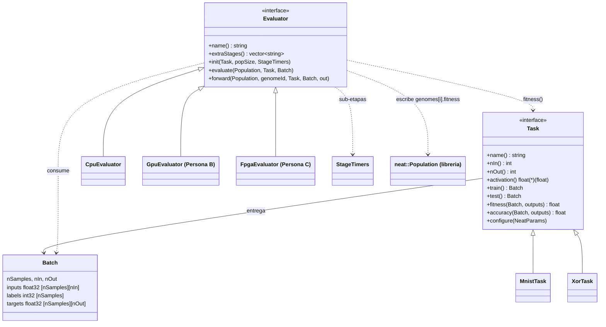
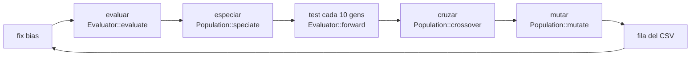

# Arquitectura de `neuroevo`

El ciclo evolutivo (`main.cpp`) no sabe **qué problema** resuelve ni **dónde** se evalúa:
eso lo deciden una `Task` y un `Evaluator`, que se eligen por línea de comandos.

## Diagrama de clases

## Flujo de una generación

Solo la etapa **evaluar** cambia entre CPU, GPU y FPGA. Especiar, cruzar y mutar siguen en CPU
(sumadas son ~35 % del tiempo en el perfilado base; ver `examples/mnist/profiling`).

## Dónde vive cada cosa

| Pieza | Archivo |
|---|---|
| Interfaces `Task`, `Batch`, `NeatParams` | `include/neuroevo/task.hpp` |
| Interfaz `Evaluator` | `include/neuroevo/evaluator.hpp` |
| Evaluador CPU (OpenMP) | `src/cpu_evaluator.cpp` |
| Cronómetros por etapa | `include/neuroevo/timers.hpp` |
| MNIST / XOR | `tasks/mnist_task.cpp`, `tasks/xor_task.cpp` |
| Selección por nombre (`--task`, `--eval`) | `src/registry.cpp` |
| Ciclo evolutivo, CLI, CSV | `main.cpp` |
