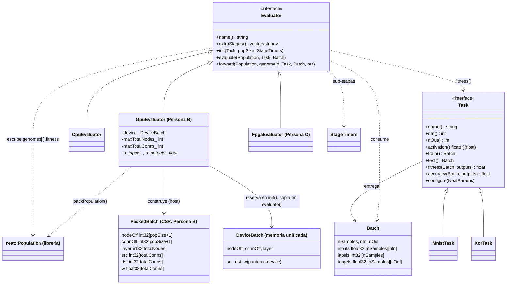
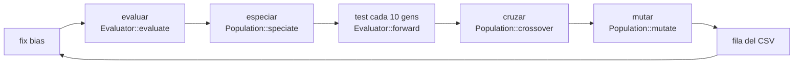
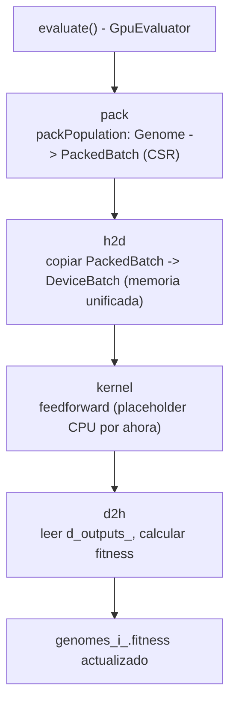

# Arquitectura de `neuroevo`

El ciclo evolutivo (`main.cpp`) no sabe **qué problema** resuelve ni **dónde** se evalúa:
eso lo deciden una `Task` y un `Evaluator`, que se eligen por línea de comandos.

## Diagrama de clases

## Flujo de una generación

Solo la etapa **evaluar** cambia entre CPU, GPU y FPGA. Especiar, cruzar y mutar siguen en CPU
(sumadas son ~35 % del tiempo en el perfilado base; ver `examples/mnist/profiling`).

## Flujo interno de `evaluar` en GpuEvaluator (Persona B)

Las cuatro sub-etapas (`pack`, `h2d`, `kernel`, `d2h`) se declaran en `extraStages()` y se miden por separado en el CSV (`t_pack`, `t_h2d`, `t_kernel`, `t_d2h`), incluidas dentro del tiempo total de `evaluar`.

**Estado actual:** El bloque `kernel` ejecuta la misma lógica que `CpuEvaluator`, accediendo y modificando los mismos punteros de memoria unificada que se utilizarán en el verdadero kernel CUDA de Persona C. Esto posibilita la validación de la interfaz, el CSV de sub-etapas y la corrección (igual a `CpuEvaluator`) antes de que el núcleo esté presente. Así, para integrarlo posteriormente solo es necesario sustituir lo que hay en el bloque `kernel`, sin modificar `pack`, `h2d` ni `d2h`.

## Dónde vive cada cosa

| Pieza | Archivo |
|---|---|
| Interfaces `Task`, `Batch`, `NeatParams` | `include/neuroevo/task.hpp` |
| Interfaz `Evaluator` | `include/neuroevo/evaluator.hpp` |
| Evaluador CPU (OpenMP) | `src/cpu_evaluator.cpp` |
| Evaluador GPU (Persona B) | `include/neuroevo/gpu_evaluator.hpp`, `src/gpu_evaluator.cu` |
| Empaquetado CSR (`Genome` → `PackedBatch`) | `include/neuroevo/packing.hpp`, `src/packing.cpp` |
| Cronómetros por etapa | `include/neuroevo/timers.hpp` |
| MNIST / XOR | `tasks/mnist_task.cpp`, `tasks/xor_task.cpp` |
| Selección por nombre (`--task`, `--eval`) | `src/registry.cpp` |
| Ciclo evolutivo, CLI, CSV | `main.cpp` |
