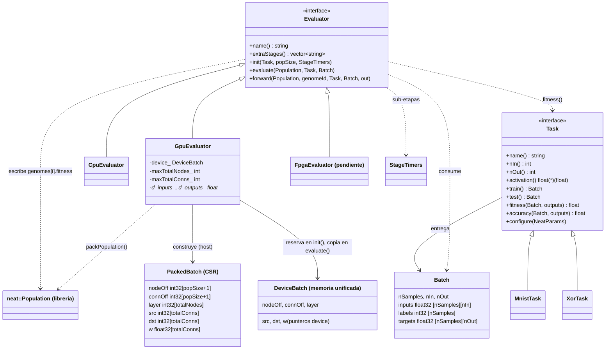
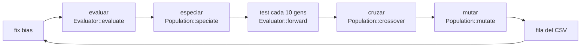
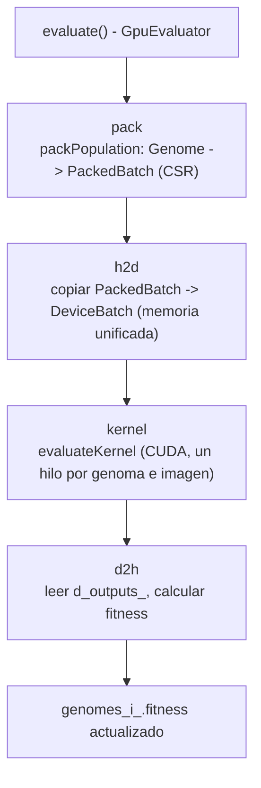

# Arquitectura de `neuroevo`

El ciclo evolutivo (`main.cpp`) no sabe qué problema resuelve ni dónde se evalúa:
eso lo deciden una `Task` y un `Evaluator`, que se eligen por línea de comandos.

## Diagrama de clases




## Flujo de una generación



Solo la etapa evaluar cambia entre CPU, GPU y FPGA. Especiar, cruzar y mutar siguen en CPU
(sumadas son ~35 % del tiempo en el perfilado base; ver `examples/mnist/profiling`).


## Flujo interno de `evaluar` en GpuEvaluator



Las cuatro sub-etapas (`pack`, `h2d`, `kernel`, `d2h`) se declaran en `extraStages()` y se miden por separado en el CSV (`t_pack`, `t_h2d`, `t_kernel`, `t_d2h`), incluidas dentro del tiempo total de `evaluar`.

Estado actual: el bloque `kernel` lanza `evaluateKernel` sobre los punteros de memoria unificada que se reservan en `init()`, con bloques de 128 hilos y un hilo por cada combinación de genoma e imagen. Cada hilo guarda los nodos ocultos y de salida en un arreglo local de `MAX_CAJAS` (303) posiciones; si un genoma necesita más, `evaluate()` se detiene con un error antes de lanzar el kernel. El kernel usa una sigmoide fija y la aptitud se calcula en la CPU (`d2h`) con la misma `Task::fitness` que usa `CpuEvaluator`.

## Formato del lote empaquetado (`PackedBatch`)

La librería guarda cada genoma como `std::vector<Node>` y `std::vector<Connection>`, que no sirve para el dispositivo. Por eso, en cada generación `packPopulation` construye en el host un formato CSR (estructura de arreglos):

```
nodeOff[popSize+1]   int32   // inicio de los nodos de cada genoma
connOff[popSize+1]   int32   // inicio de las conexiones de cada genoma
layer[totalNodes]    int32   // capa de cada nodo (0 = bias e inputs)
src[totalConns]      int32   // id local del nodo origen
dst[totalConns]      int32   // id local del nodo destino
w[totalConns]        float32 // peso
```

Reglas (salen de `Genome::runNetwork`, cualquier evaluador las debe respetar):

1. Ids locales: `0` = bias (valor fijo 1.0), `1..nIn` = entradas, `nIn+1..nIn+nOut` = salidas, el resto ocultos.
2. Solo se empaquetan las conexiones habilitadas (`enabled == true`) y no recurrentes.
3. Cada conexión va hacia una capa mayor (`layer[src] < layer[dst]`). Con `recurrent=false` ya viene así.
4. Orden de evaluación: para `l = 0 .. capaSalida-1`, acumular las conexiones cuyo origen está en la capa `l` y luego aplicar la activación a los nodos de la capa `l+1`.
5. Un nodo que no es entrada y no tiene conexiones entrantes vale `activation(0)` (en sigmoide, 0.5), no 0.
6. Todas las salidas están en la misma (última) capa.
7. El bias en 1.0 es una corrección que hace `main` (`--no-fix-bias` la desactiva); la librería lo deja en 0.

El tamaño máximo del lote se reserva una sola vez en `init()`, con un margen de 3 veces la media de conexiones por genoma observada en el perfilado (cerca de 1970 en MNIST). Si una generación lo supera, `evaluate()` falla con un mensaje explícito. `tests/test_core.cpp` trae una red XOR armada a mano que sirve como caso exacto para validar cualquier evaluador.

## Dónde vive cada cosa

| Pieza | Archivo |
|---|---|
| Interfaces `Task`, `Batch`, `NeatParams` | `include/neuroevo/task.hpp` |
| Interfaz `Evaluator` | `include/neuroevo/evaluator.hpp` |
| Evaluador CPU (OpenMP) | `src/cpu_evaluator.cpp` |
| Evaluador GPU (CUDA) | `include/neuroevo/gpu_evaluator.hpp`, `src/gpu_evaluator.cu` |
| Empaquetado CSR (`Genome` → `PackedBatch`) | `include/neuroevo/packing.hpp`, `src/packing.cpp` |
| Cronómetros por etapa | `include/neuroevo/timers.hpp` |
| MNIST / XOR | `tasks/mnist_task.cpp`, `tasks/xor_task.cpp` |
| Selección por nombre (`--task`, `--eval`) | `src/registry.cpp` |
| Ciclo evolutivo, CLI, CSV | `main.cpp` |
